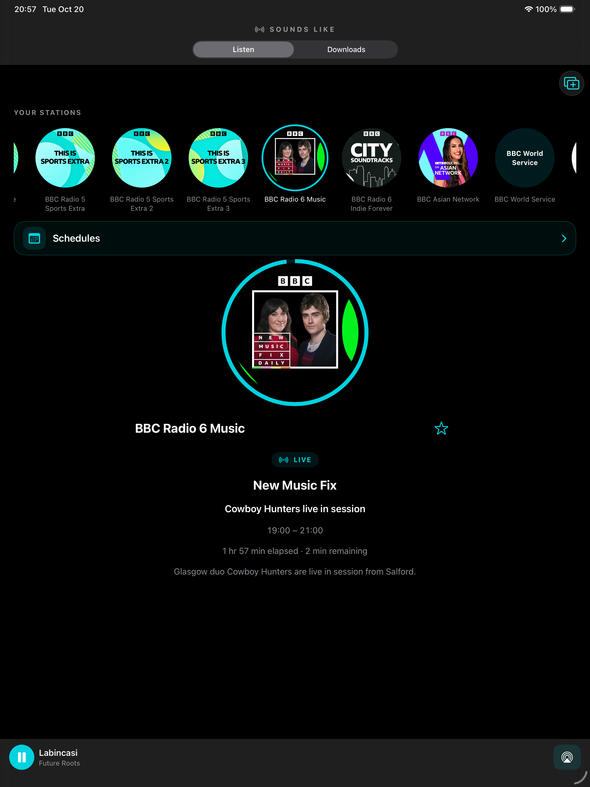

# Sounds Like

A native radio player for iPhone, iPad and Apple TV, with shared Swift playback and BBC programme data. Independent project; not affiliated with or endorsed by the BBC.



## Features

- BBC national, nations, local and extra station catalogue, with current programme artwork and track information when supplied.
- Live playback, background audio, AirPlay, Lock Screen controls and live rewind within the available stream window.
- Favourites, listening positions and iPhone/iPad download selections sync through iCloud using the same Apple Account.
- Schedules, inline search and catch-up playback for available programmes. Select a show to play it; select it again to return to Now Playing.
- Long-press available shows on iPhone/iPad to download. Manage and delete saved shows in Downloads. Each device downloads its own offline audio.
- iPad multi-window support and a wide, horizontally scrolling programme guide with vertically scrolling stations.
- Apple TV remote focus navigation, smooth touchpad scrubbing, auto-hiding favourites and centred playback content.
- Apple TV Top Shelf extension with favourites and recently played items, linking into playback.
- Siri media intent integration on iOS.

## Apps and build targets

| Platform | Xcode scheme | Status |
| --- | --- | --- |
| iPhone | RadioBridge | Universal iOS app; physical playback tested |
| iPad | RadioBridge | Same app with adaptive layout and multiple windows; physical testing completed |
| Duo outer / inner layouts | RadioBridge | Compact / expanded adaptive previews; actual hardware and fold transitions unverified |
| Apple TV | SoundsLikeTV | Native tvOS app and Top Shelf extension; latest source builds; latest physical deployment blocked by device connection |
| CarPlay | RadioBridge with CarPlay entitlements | Templates included; requires Apple audio entitlement approval and in-car validation |

Minimum deployment target: iOS/iPadOS 17 and tvOS 17. Current source validated using Xcode 27. The internal project is still named RadioBridge.

## Build

Open `RadioBridge.xcodeproj`. Choose **RadioBridge** for iPhone/iPad or **SoundsLikeTV** for Apple TV.

For simulator builds without personal signing:

```sh
./scripts/build-all.sh
```

This builds Release simulator apps for iPhone/iPad (including adaptive layouts and compiled CarPlay templates), and Apple TV including Top Shelf. Outputs are in `build-public-ios` and `build-public-tv`.

For physical devices, follow [signing and installation](docs/BUILDING.md). No certificates, provisioning profiles, downloaded programmes or personal device logs are published. Simulator apps cannot be installed directly on physical devices. This repository is not an App Store or TestFlight release.

## Screenshots and guide

[Six-page A3 app guide (PDF)](docs/Sounds-Like-App-Guide-A3.pdf)

| App / layout | Now Playing | Schedule |
| --- | --- | --- |
| iPhone | [View](docs/screenshots/iphone-now-playing.png) | [View](docs/screenshots/iphone-schedule.png) |
| iPad | [View](docs/screenshots/ipad-now-playing.png) | [View](docs/screenshots/ipad-schedule.png) |
| Apple TV | [View](docs/screenshots/tv-now-playing.png) | [View](docs/screenshots/tv-schedule.png) |
| Duo inner preview | [View](docs/screenshots/duo-inner-preview-now-playing.png) | [View](docs/screenshots/duo-inner-preview-schedule.png) |
| Duo outer preview | [View](docs/screenshots/duo-outer-preview-now-playing.png) | [View](docs/screenshots/duo-outer-preview-schedule.png) |

Screenshots use simulator captures. Duo images illustrate expanded and compact layouts; the outer preview uses the iPhone layout. They are not captures from verified Duo hardware.

## Checks

```sh
./scripts/test.sh
```

Tests cover station aliases, metadata, live seek limits, schedule decoding and expiry, date boundaries, and listening checkpoint conflict ordering. Network stream checks are separate: `python3 scripts/verify-streams.py`.

## Availability and content

Streams, artwork, schedules and catch-up availability depend on BBC services, location and programme availability. Track information may be absent or delayed. Rewind is limited to the stream's seekable range. iCloud delivery is asynchronous. Download sync distributes requests, not audio through iCloud. Siri and HomePod routing are controlled by Apple and require device testing.

BBC names, programme images and audio belong to their respective owners. This repository does not include downloaded audio or grant rights to BBC content. No open-source licence has been selected for the original app code.

## Source layout

`App/` contains iOS UI, playback and CarPlay templates; `Shared/` contains stations, favourites, schedules and listening/download state; `TV/` contains the tvOS interface; `TopShelf/` contains the TV extension; `Intents/` contains the Siri extension; `Tests/` contains focused checks.
